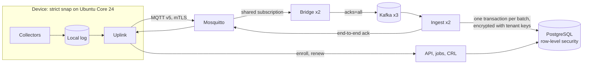

# fleetwire

A telemetry pipeline for fleets of Ubuntu Core devices that stores every
reading exactly once, through network cuts, broker and database outages,
process kills and power loss, and keeps each tenant's data apart and
encrypted with the tenant's own keys.

> For every device, every seq that left the device is, after the system
> recovers, either stored exactly once, or covered by a gap that the device
> itself reported. No seq is stored twice. No seq disappears without a
> report.

The agent keeps each reading on disk until an end-to-end acknowledgement
says it is stored. Every hop in between (MQTT QoS 1, Kafka, the consumer
group) may lose or repeat messages, and the agent resends until the ack
comes. Ingest removes the repeats under a per-device row lock, and a
PostgreSQL exclusion constraint makes storing a seq twice impossible.
[The delivery guarantee](docs/explanation/delivery-guarantee.md) has the
argument and its limits.



## Results

Every scenario runs the real stack (`make up`) with thousands of real agent
instances in one process, injects the fault (or kills the process), keeps
the load on, and then reads everything back from the database, decrypted.
A scenario passes only with 0 missing and 0 duplicate seqs. Recovery is the
time from the end of the fault until the p99 delay from collection to
commit is under 5 s again.

All runs below used one UpCloud VM (4 vCPU AMD EPYC 9575F, 8 GB RAM,
Ubuntu 26.04) for the load generator, the whole stack and the observability
tools, at commit `add94424b241`. The tables, with the exact commands, are in
[`docs/results/`](docs/results/).

**2,000 devices**, one reading every 10 s each, device state on disk
(`make chaos`):

| Scenario | Readings | Missing | Duplicates | Recovery | Result |
|---|---:|---:|---:|---:|---|
| network cut, 60 s | 44,314 | 0 | 0 | 1m16s | PASS |
| network degraded (300 ± 200 ms, 512 KB/s, 5% resets), 120 s | 51,659 | 0 | 0 | 0s | PASS |
| Mosquitto restart | 23,604 | 0 | 0 | 0s | PASS |
| one Kafka broker killed, 60 s | 35,667 | 0 | 0 | 0s | PASS |
| all Kafka brokers stopped, 60 s | 41,088 | 0 | 0 | 52s | PASS |
| PostgreSQL killed, 60 s | 35,688 | 0 | 0 | 36s | PASS |
| bridge SIGKILL, 30 s | 34,109 | 0 | 0 | 0s | PASS |
| ingest SIGKILL, 30 s | 35,205 | 0 | 0 | 0s | PASS |
| agent SIGKILL (all 2,000 at once) | 23,234 | 0 | 0 | 0s | PASS |

**10,000 devices**, one reading every 10 s each (1,000 readings/s), device
state on tmpfs (see Limitations):

| Scenario | Readings | Missing | Duplicates | Recovery | Result |
|---|---:|---:|---:|---:|---|
| network cut, 60 s | 482,255 | 0 | 0 | 4m48s | PASS |
| network degraded, 120 s | 647,059 | 0 | 0 | 6m40s | PASS |
| Mosquitto restart | 411,034 | 0 | 0 | 4m33s | PASS |
| one Kafka broker killed, 60 s | 681,276 | 0 | 0 | 8m17s | PASS |
| all Kafka brokers stopped, 60 s | 794,433 | 0 | 0 | > 10m | PASS |
| PostgreSQL killed, 60 s | 792,362 | 0 | 0 | > 10m | PASS |
| bridge SIGKILL, 30 s | 590,336 | 0 | 0 | 7m2s | PASS |
| ingest SIGKILL, 30 s | 765,866 | 0 | 0 | > 10m | PASS |
| agent SIGKILL (all 10,000 at once) | 280,421 | 0 | 0 | 3m2s | PASS |

Every reading was stored exactly once, but not on time. The VM was
saturated (load average about 90, 4 GB in swap): in the steady minute
before each fault ingest stored 870 to 990 readings/s, a backlog of about
20,000 records from the ramp-up never cleared, and the p99 delay was about
30 s. Recovery, measured as "p99 under 5 s again", took minutes; "> 10m"
means the runner stopped waiting.

**Power loss**: 10 hard resets (QMP `system_reset`) of a VM running the
agent snap, at random moments, with a collection every 200 ms (11
readings from the built-in collectors, about 55 readings/s) and
`wal.sync=interval`: 9,089 readings, all acknowledged, 0 missing,
0 duplicates. The VM ran Ubuntu Server 24.04, not Ubuntu Core (see
Limitations).

| Target | Measured |
|---|---|
| Correctness: 0 missing, 0 duplicates in every failure scenario | Met: 9 of 9 at 2,000 devices, 9 of 9 at 10,000, and 10 power cuts |
| Scale: 10,000 devices, one reading every 10 s, on one dev VM | All 10,000 ran and every reading was stored once, with the devices' state on tmpfs; with it on the database's disk, ingest stored about 770 of 1,000 readings/s |
| Latency: p99 from collection to commit under 5 s at normal load | Met at 2,000 devices: p99 2.49 s, p50 2.20 s over 6 steady minutes, most of it the agent's own 1 s batch wait and 1 s fsync interval. Not met at 10,000: about 30 s |
| Throughput: highest rate before the lag keeps growing | 1,000 batches/s of one reading (p99 2.5 s); at 1,500/s the lag crept up. In batches of 64, 32,000 readings/s ([table](docs/results/2026-11-10T044759Z-add94424b241-throughput.md)) |
| Agent: under 30 MB RSS, binary under 20 MB | 19.7 to 21.9 MB RSS (the snap daemon, and an agent with six collectors over 12 minutes); binary 16.2 MB, snap 5.2 MB |

## Quick start

You need Linux with Docker (Compose v2), Go (the version in `go.mod`) and
`make`.

```console
$ make demo        # dev CA, stack, migrations, 5 real agents, 60 s of data
$ make e2e         # end-to-end test against the stack
$ make chaos SCENARIOS=network-cut,ingest-kill DEVICES=200
```

`make demo` prints the tenant token and where to look: the API (with
`fwctl`), Grafana on http://localhost:3000, Prometheus and Jaeger. The
[tutorial](docs/tutorial/run-a-fleet.md) walks through it, and
[Run the failure tests](docs/how-to/run-failure-tests.md) covers the suite.

On a device, build the snap (`make snap`, snapcraft with LXD) and install it;
it is not in the Snap Store yet:

```console
$ sudo snap install --dangerous ./fleetwire-agent_*.snap
$ sudo snap set fleetwire-agent enroll.url=https://api.example.com:8444 enroll.token=fwe_...
```

On Kubernetes, the Juju charms deploy the backend with Charmed PostgreSQL
and Charmed Kafka: [Deploy with Juju](docs/how-to/deploy-with-juju.md).

Tagged releases attach Linux binaries, `fwctl` for Linux and macOS, SPDX
SBOMs and a signed checksum file, and push the API, bridge and ingest
images to GHCR. [Verify a release](docs/how-to/verify-a-release.md) shows
how to check the signatures.

## What is in the repository

| Path | What |
|---|---|
| `cmd/fleetwire-agent`, `internal/agent`, `internal/wal` | the device agent, its local log and uplink |
| `cmd/fleetwire-bridge`, `internal/bridge` | Mosquitto to Kafka, acking only after Kafka confirms |
| `cmd/fleetwire-ingest`, `internal/ingest`, `internal/coverage` | exactly-once storage, encryption, acks |
| `cmd/fleetwire-api`, `internal/api`, `internal/jobs`, `api/openapi.yaml` | tenant, operator and device API; retention, exports, destroy |
| `internal/store` | PostgreSQL schema, row-level security, migrations |
| `cmd/fwctl` | the CLI |
| `cmd/fleetwire-loadgen`, `-checker`, `-chaos`, `scripts/throughput.sh` | load generator, checker, failure suite, throughput search |
| `snap/`, `deploy/ubuntu-core/` | the agent snap and the VM scripts for the power-off test |
| `charms/` | Juju charms, the bundle and its integration test |
| `deploy/compose/`, `deploy/prometheus/`, `deploy/grafana/` | development stack, SLO rules, dashboard |
| `docs/` | Sphinx docs (Diátaxis) and the ADRs |

## Limitations

- **10,000 devices are more than the test VM serves on time.** Every
  reading was stored once, but with the load generator, the stack and the
  observability tools on 4 vCPUs and 8 GB, the p99 delay was about 30 s.
  Even that needs the devices' state on tmpfs: each simulated device fsyncs
  its local log and state file, as a real device does on its own disk, and
  on one VM those fsyncs, about 3,000 a second, share the disk with
  PostgreSQL's commits. With the state on disk, ingest stored about 770 of
  the 1,000 readings/s offered. The tmpfs runs do not test power loss; the
  power-off test does.
- **The power-off test ran on Ubuntu Server 24.04, not Ubuntu Core.**
  Ubuntu Core's first boot needs an Ubuntu One account, so it could not be
  automated. The agent ran as the same strict snap on a real kernel and
  ext4, under QEMU without KVM; Ubuntu Core's own boot and partition layout
  were not tested.
- **The agent snap is not in the Snap Store.** Build it with `make snap`
  and install it with `--dangerous`. The release publishes binaries and
  container images only.
- **One API unit on Kubernetes.** The local keyring keeps the tenant KEKs
  on the unit's storage. A Vault or KMS keyring backend would lift this.
- **Revocation at the broker lags on Kubernetes** by up to the
  update-status interval (5 minutes by default). Ingest drops a revoked
  device's data at once; in Compose the broker reloads its CRL within
  seconds.
- **Charmed PostgreSQL must be dedicated to fleetwire**: the runtime
  logins' `charmed_dml` role can read and write every database of the
  cluster.
- **Row-level security guards against tenant-scoping mistakes, not a
  compromised service**: any session of the runtime role can choose a
  tenant. What such a service cannot do is change the schema, drop the
  policies or rewrite the audit log.
- **Destroying a tenant deletes its KEK file**, which is not a secure erase
  on an SSD; production should use a KMS with real key destruction.
- **The database cannot aggregate readings**: they are encrypted with
  tenant keys, so the API decrypts them for every query.
- **Latency uses the device's clock** (collection time to commit), so a
  device with a wrong clock skews the delay SLO;
  `fleetwire_ingest_clock_skew_seconds` shows how far off devices are.
- **The load generator's devices share one kernel, network stack and
  disk**, and their reading values are synthetic; see
  [how it differs from a real device](docs/explanation/load-generator.md).

## Future work

- A Vault Transit or cloud KMS keyring backend: real key destruction, and
  more than one API unit on Kubernetes. The `Keyring` interface is ready.
- Over-the-air agent updates beyond what snap refreshes give.
- A web frontend; aggregation and downsampling of readings.
- Rocks for the workloads and deb packages for non-snap systems.
- Multi-region replication.

## License

Apache License 2.0. Copyright Reda Alaarabi.
