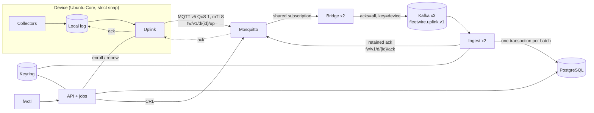

# Architecture

| Binary | Runs where | Job |
|---|---|---|
| `fleetwire-agent` | device (snap) | collect, write the local log, send, handle acks, enroll, renew |
| `fleetwire-bridge` | backend | Mosquitto to Kafka; acks MQTT only after Kafka confirms |
| `fleetwire-ingest` | backend | Kafka to PostgreSQL; removes repeats, encrypts, publishes acks |
| `fleetwire-api` | backend | tenant, operator and device API, background jobs, CRL, migrations |
| `fwctl` | operator laptop | CLI for the API |
| `fleetwire-loadgen` | test machine | thousands of real agent instances |
| `fleetwire-checker` | test machine | reads stored data back and proves the guarantee |
| `fleetwire-chaos` | test machine | failure scenarios and the results table |

## Trust and data flow

- Devices authenticate with certificates whose CN is a server-generated
  device ID (ADR-0009). The broker ACL pins each device to its own topics.
  The tenant always comes from the device registry.
- Services connect as the runtime role (`fleetwire_app` in Compose), which
  cannot bypass row-level security and owns nothing; every tenant query runs
  in a transaction scoped to one tenant (ADR-0006).
- Readings are encrypted with the tenant's data key before they are written;
  data keys are wrapped by a per-tenant key-encryption key that lives
  outside the database (ADR-0007).

## On Kubernetes

The Juju charms run each service in its own pod (ADR-0012). Two things the
Compose stack gets from sharing a host are replaced by network calls:

- **Keyring.** The KEKs stay on the API unit's storage. Ingest wraps and
  unwraps data keys through the API's keyring listener (`:8445`, mutual TLS,
  only the `fleetwire-ingest` certificate). KEKs never leave the API.
- **CRL.** The API serves its latest CRL at `GET /v1/crl`; the Mosquitto
  charm fetches it on every update-status hook and reloads Mosquitto with
  SIGHUP when it changed.

- **Database logins.** Charmed PostgreSQL cannot create roles for an
  application and makes a plain relation user the owner at login. The API
  therefore has two relations: the owner, used only for migrations, and a
  runtime login with the extra user role `charmed_dml`. Ingest has its own
  `charmed_dml` login. The migrations give the policies and grants to the
  `charmed_dml` group.

## Where the guarantee lives

See [the delivery guarantee](delivery-guarantee.md). In short: the device
keeps everything until an end-to-end ack, every hop in between may repeat,
and ingest stores each seq once under a per-device row lock.
