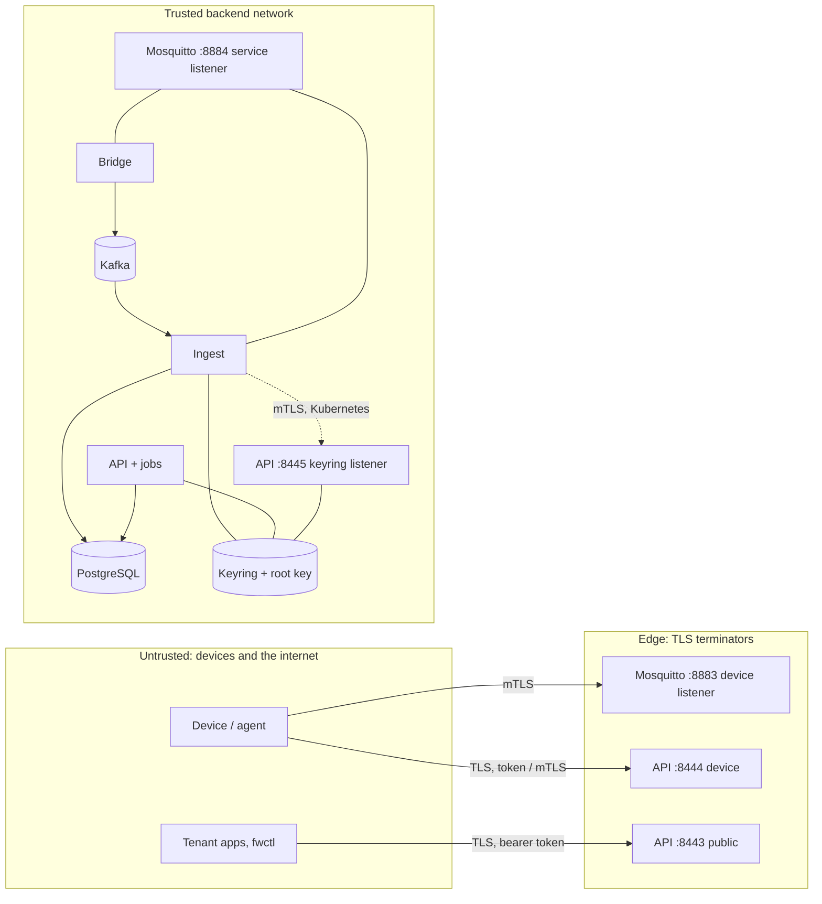

# Threat model

STRIDE analysis of fleetwire as built. "Accepted" means the risk is known
and not handled in code; the reason is given.

## Trust boundaries

In Compose, ingest and the API share the keyring directory on one host. In
Kubernetes, ingest has no KEK and no root key: it wraps and unwraps data keys
through the API's keyring listener (ADR-0012). The services Juju creates for
the broker and the API carry the internal listeners (8884, 8445) for the
backend's own clients, so only separate services with the edge ports are
exposed ([deploy guide](../how-to/deploy-with-juju.md)).

## STRIDE table

| # | Category | Threat | Handling |
|---|---|---|---|
| S1 | Spoofing | A device claims another device's ID | Device IDs are server-generated UUIDs in the CN and a URI SAN; the CSR subject is ignored (ADR-0009). The ACL pins topics to the CN. |
| S2 | Spoofing | A device claims a service name (`fleetwire-ingest`) to publish acks | The API gives device certificates UUID CNs only; services use certificates from a separate service CA on a listener devices cannot reach. Each Mosquitto listener has its own ACL: the device listener (8883) has only the per-device pattern rules, so a device CA certificate with a service CN gets device rights there and nothing more, and on the service listener (8884) only `fleetwire-bridge` and `fleetwire-ingest` have rights. The service listener trusts the root CA, so such a certificate would get service rights on 8884: keep 8884 on the internal network. |
| S3 | Spoofing | A device claims another tenant | The tenant comes only from the device registry, never from the payload. |
| S4 | Spoofing | Stolen device key used elsewhere | Revoke the device: ingest drops its data from the commit on, and the broker refuses it after the CRL reload (ADR-0010). Certificates expire after 30 days. |
| S5 | Spoofing | Leaked API or operator token | Only SHA-256 hashes are stored; tokens are scoped, revocable, show `last_used_at`, and carry prefixes (`fwt_`, `fwo_`, `fwe_`) that secret scanners recognise. |
| S6 | Spoofing | Leaked enrollment token | Single use, 15 minutes by default, consumed atomically; every attempt is audited. |
| S7 | Spoofing | Another service or a device calls the keyring listener | Client certificates must chain to the service CA (devices are on another CA), and only the CN `fleetwire-ingest` is admitted; a refusal is logged with the CN. |
| T1 | Tampering | A ciphertext is moved to another row or tenant | The AAD binds tenant, device, seq range and key ID; decryption fails. |
| T2 | Tampering | Modified readings in transit | TLS on every device link; the device's own readings are not signed end to end (accepted: the broker and backend are trusted). |
| T3 | Tampering | Audit log rewritten | Insert-only grants plus a trigger that rejects UPDATE, DELETE and TRUNCATE for every role, including the owner. A database superuser is out of scope. |
| T4 | Tampering | SQL injection | Only parameterized queries (pgx); no SQL is built from input. |
| T5 | Tampering | Forged or edited paging cursor | Cursors are HMAC-signed and bound to the endpoint, tenant and query. |
| R1 | Repudiation | Operator or tenant denies an action | Every admin and governance action is in the append-only audit log with actor, target and result. |
| I1 | Information disclosure | Tenant A reads tenant B's data | Forced row-level security, transaction-local tenant setting, composite foreign keys, minimum-column definer functions, cross-tenant tests in SQL and through the API (ADR-0006). |
| I2 | Information disclosure | Database backup leaks | Readings are encrypted with tenant keys whose KEKs live outside the database. After a tenant destroy, old backups cannot be decrypted. |
| I3 | Information disclosure | Metadata in clear (device, seq range, times, counts) | Accepted: needed for queries and retention (ADR-0007). |
| I4 | Information disclosure | Secrets in logs | Token types redact themselves in fmt and slog; config errors redact secret values; internal errors are not returned to clients. |
| I5 | Information disclosure | Export files on disk | Accepted with a condition: plaintext for up to 24 h, deleted on expiry and on tenant destroy; the export directory must be on an encrypted volume. |
| I6 | Information disclosure | Data keys on the wire to ingest (Kubernetes) | TLS 1.2+ with mutual authentication on the internal listener; only data keys travel, never KEKs; answers are `no-store`. A captured key opens only that tenant's chunks sealed with it, which the network attacker would also need. |
| I7 | Information disclosure | The public CRL endpoint | Accepted: a CRL is public by design (signed serial numbers and revocation times, no device or tenant names). |
| D1 | Denial of service | A device floods the broker | `max_packet_size`, receive maximum, the agent's in-flight window, and Kafka backpressure. |
| D2 | Denial of service | Poison batch stops ingest | Invalid batches go to the dead-letter topic with a reason; ingest continues. |
| D3 | Denial of service | API abuse | Per-token rate limits with `Retry-After`, per-address limits on enrollment, 1 MiB body limit, server timeouts. Limits are per replica (accepted). |
| D4 | Denial of service | CRL expires | Daily republish; alert at 48 h; the CRL is valid 7 days. |
| D5 | Denial of service | Device disk fills during a long outage | Disk budget drops the oldest segment as a reported gap instead of failing. |
| E1 | Elevation of privilege | Service compromised and used to read every tenant | Services run as the runtime role (no BYPASSRLS, owns nothing) and check that at start, so they cannot change the schema, drop policies or disable the audit trigger. They can still set the tenant setting to any tenant: row-level security guards against scoping mistakes, not against a compromised service. In Compose a compromised ingest process holds the keyring root key; in Kubernetes it can ask the API to unwrap keys while it runs, but holds no KEK. Accepted: the backend is a trust boundary. |
| E5 | Elevation of privilege | The runtime logins on Charmed PostgreSQL are wider than fleetwire needs | They hold `charmed_dml` (`pg_read_all_data`, `pg_write_all_data`) on every database of the cluster they can connect to; row-level security still applies to fleetwire's tables. Handled by deployment: fleetwire gets a PostgreSQL of its own (ADR-0012). |
| E2 | Elevation of privilege | Snap escapes confinement or over-asks | Strict confinement, four interfaces, each justified in `snap/snapcraft.yaml`. |
| E3 | Elevation of privilege | A revoked device keeps publishing over an open connection | Mosquitto does not drop open connections on CRL reload; ingest layer 1 drops the data (accepted at the broker layer). |
| E4 | Elevation of privilege | Supply chain | Actions pinned by commit SHA, Dependabot, govulncheck in CI, SBOM and cosign signatures on releases. |

## Out of scope

- A malicious database superuser or host administrator.
- Physical attacks on devices beyond key theft (handled by revocation).
- Side channels in the Go runtime or OpenSSL.
